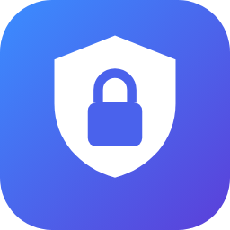
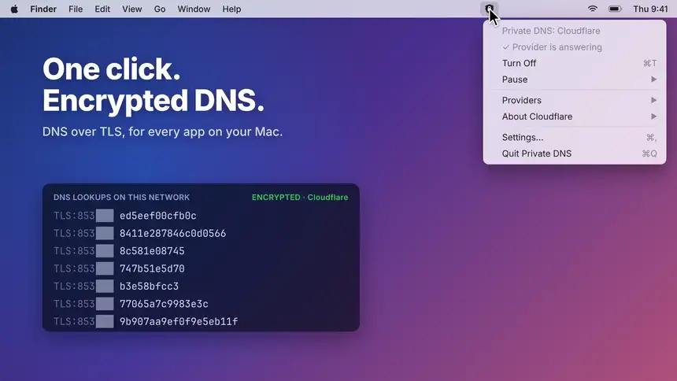
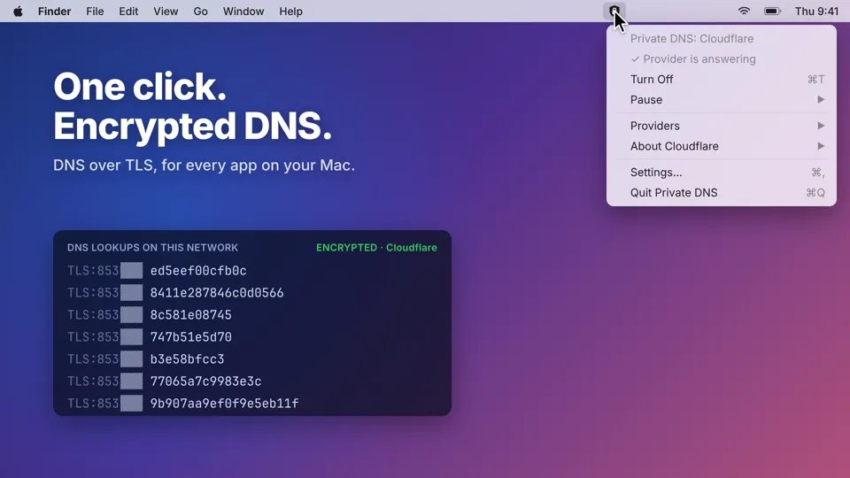
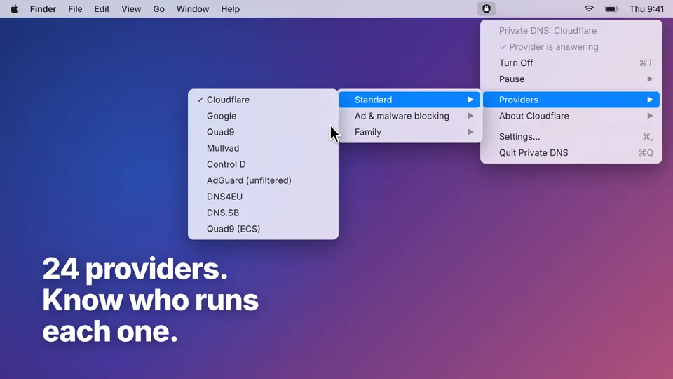
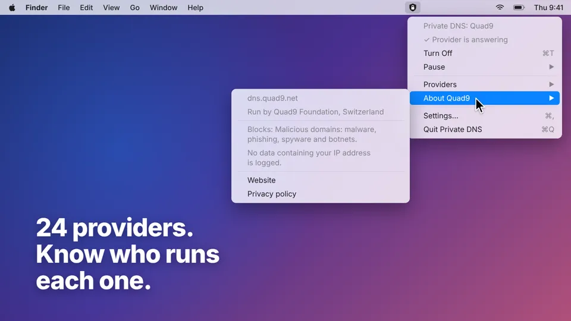
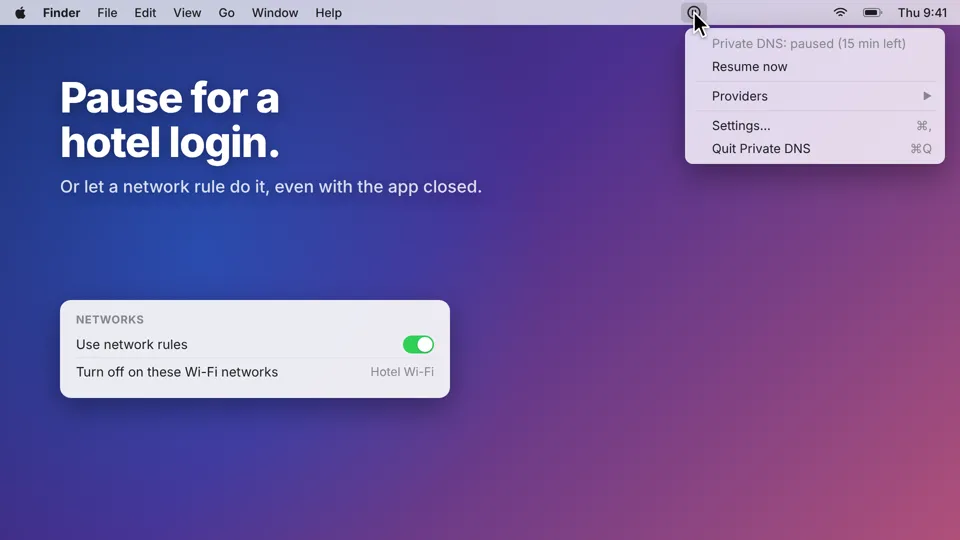

<div align="center">



# Private DNS

**Encrypted DNS from your Mac's menu bar.**

A small Mac menu bar app that turns on DNS over TLS for every app on your Mac, with a provider you choose in advance, in one click. Your Wi-Fi, your ISP and the hotel network stop seeing every site you look up. 
It's the "cousin" version for macOS of [Private DNS Changer](https://github.com/neteinstein/Private-DNS-Changer) for Android.

[](Resources/Info.plist)
[](https://github.com/neteinstein/MacOS-MenuBar-DNS-Changer/actions/workflows/ci.yml)

[](https://github.com/neteinstein/homebrew-tap)
[](https://github.com/neteinstein/MacOS-MenuBar-DNS-Changer/releases)

<a href="https://github.com/neteinstein/MacOS-MenuBar-DNS-Changer/raw/main/docs/private-dns.mp4">
  
</a>

<sub>▶ <a href="https://github.com/neteinstein/MacOS-MenuBar-DNS-Changer/raw/main/docs/private-dns.mp4">Watch with sound</a> · 22 seconds</sub>

</div>

---

## How to install

**No Terminal:** download [Private-DNS.dmg](https://github.com/neteinstein/MacOS-MenuBar-DNS-Changer/releases/latest/download/Private-DNS.dmg) and follow [Install Private DNS](docs/download.md), a step-by-step guide.

With [Homebrew](https://brew.sh/):

```bash
brew install neteinstein/tap/macos-dns-changer
```

```bash
brew trust --formula neteinstein/tap/macos-dns-changer
```

```bash
brew services start neteinstein/tap/macos-dns-changer
```

The first command builds the app on your Mac and installs it. The second marks it as trusted, since recent Homebrew versions won't run formula code from a third-party tap until you say you trust it. The third starts it now and at every login. It needs macOS 13 or later; more in [Install](#install).

## Why

Your Mac asks a DNS server for the address of every site and app it talks to, and by default it asks in plain text. Whoever runs the network (the café Wi-Fi, the hotel, your ISP) can read the list, and can change the answers.

Encrypted DNS fixes that, but on a Mac it hides behind configuration profiles and Network Extension settings. Private DNS puts it in the menu bar: pick a provider once, then it's one click to turn on, off, pause, or switch.

## A look around

<table>
<tr>
<td width="50%" valign="top">

<b>One click.</b> <b>Turn On</b> uses the provider you picked. The menu shows who's in use and whether it's answering.
</td>
<td width="50%" valign="top">

<b>24 providers</b>, standard, ad and malware blocking, and family filters, plus NextDNS and your own hostname.
</td>
</tr>
<tr>
<td width="50%" valign="top">

<b>Know who runs it.</b> Each provider's operator, country, what it blocks and its privacy policy.
</td>
<td width="50%" valign="top">

<b>Pause</b> for a hotel sign-in page, or let a <b>network rule</b> turn it off on the networks that need their own DNS.
</td>
</tr>
</table>

<sub>Pictures from the demo video, which draws the app's own menu in the macOS style.</sub>

## What it does

- **Turns encrypted DNS on and off** from the menu bar, or with ⌘T while the menu is open: DNS over TLS for every app on the Mac, not just the browser.
- **Offers 24 providers:** Cloudflare, Google, Quad9, Mullvad, Control D, AdGuard, DNS4EU, DNS.SB and CleanBrowsing, with their ad-blocking and family filters. Add a **NextDNS** configuration ID or any DNS-over-TLS hostname of your own, with a name.
- **Tells you who runs each one:** the operator, where it's based, what it blocks and how it treats your data, with links to its website and privacy policy.
- **Favourites:** star providers to list them at the top of the menu. With *Toggle cycles through favourites* on, Toggle steps through them and then Off.
- **Pauses** for 5 minutes, 15 minutes or an hour, then turns itself back on.
- **Network rules:** keep it off on any Wi-Fi, on Ethernet, or on Wi-Fi networks you name. macOS applies them itself, even while the app is closed.
- **Switches back if a provider doesn't answer:** after a switch it checks the new provider resolves names, and restores the previous setting if it doesn't within about 20 seconds.
- **Scriptable:** `privatedns://on`, `off`, `toggle`, `pause` and `resume` links for Shortcuts, Raycast or Terminal, protected by a token, so a web page can't change your DNS.
- **Opens at login**, if you like.

More in [How it works](docs/how-it-works.md).

## What leaves your Mac, and where it ends up

| What | Where it ends up | When |
|---|---|---|
| Your DNS lookups (the names of the sites and services your Mac connects to), encrypted | The provider you picked | While Private DNS is on. That's the point: pick a provider whose privacy policy you're happy with; each one's is a click away in the menu. |
| One lookup of the provider's own hostname, e.g. `dns.quad9.net` | Whatever DNS your Mac is using at that moment | Just before each switch, to find the provider's addresses. |
| Lookups of `www.apple.com`, `www.wikipedia.org`, `www.icloud.com` or `www.google.com` | The provider in use | A few times after a switch, then every two minutes, to check it's answering. |

Nothing else goes anywhere: the app has no server, no analytics and no crash reporting. Your settings and automation token stay in the app's preferences on your Mac, and the profiles it makes stay in `~/Library/Application Support/PrivateDNSMenuBar/`.

## Install

With [Homebrew](https://brew.sh/):

```bash
brew install neteinstein/tap/macos-dns-changer
```

It needs macOS 13 or later and the Xcode command line tools: Homebrew builds the app on your Mac. No Terminal? [Download](#download) the app instead.

### Run it

Start it once:

```bash
open "$(brew --prefix)/opt/macos-dns-changer/Private DNS.app"
```

Or start it now and at every login:

```bash
brew services start neteinstein/tap/macos-dns-changer
```

Use `brew services` rather than **Open at login** in Settings: the service runs the app from Homebrew's `opt` folder, which keeps pointing at the newest version after `brew upgrade`.

### Download

No Homebrew or Terminal needed: [Install Private DNS](docs/download.md) walks through downloading [Private-DNS.dmg](https://github.com/neteinstein/MacOS-MenuBar-DNS-Changer/releases/latest/download/Private-DNS.dmg), dragging it into Applications and allowing it the first time (it isn't signed by Apple).

### Set it up

1. Click the lock in the menu bar, open **Providers** and pick one.
2. macOS asks you to install the profile that switches DNS: open **System Settings › Privacy & Security › Profiles**, double-click **Private DNS: <provider>** and click **Install**.

Both the DMG and Homebrew give you an app that isn't signed by Apple, so every switch is a profile to install. A build signed with Apple's Network Extension entitlement switches instantly after you allow it once in **System Settings › Network › Filters**; see [How it works](docs/how-it-works.md#two-ways-to-change-the-system-dns) and [Development](docs/development.md#signing-with-the-network-extension-entitlement).

### Update

```bash
brew update && brew upgrade macos-dns-changer
```

Then restart it with `brew services restart macos-dns-changer`, or quit it from its menu and open it again. With the DMG, download the new one and replace the app in Applications. Your settings are kept.

## Feedback and issues

Found a bug, or have an idea? [Open an issue](https://github.com/neteinstein/MacOS-MenuBar-DNS-Changer/issues).

## Learn more

- [Install Private DNS](docs/download.md): the DMG, step by step.
- [How it works](docs/how-it-works.md): the two ways it changes DNS, network rules, the connection check, pause, automation links, and how it differs from the Android app.
- [Development](docs/development.md): building, signing with the Network Extension entitlement, how the code is laid out, and the demo video.
- [Releasing](docs/releasing.md): the DMG on GitHub Releases and the Homebrew formula.

<div align="center">
<br>
<sub>Demo video made with <a href="https://github.com/latent-spaces/brag">/brag</a>.</sub>
</div>
